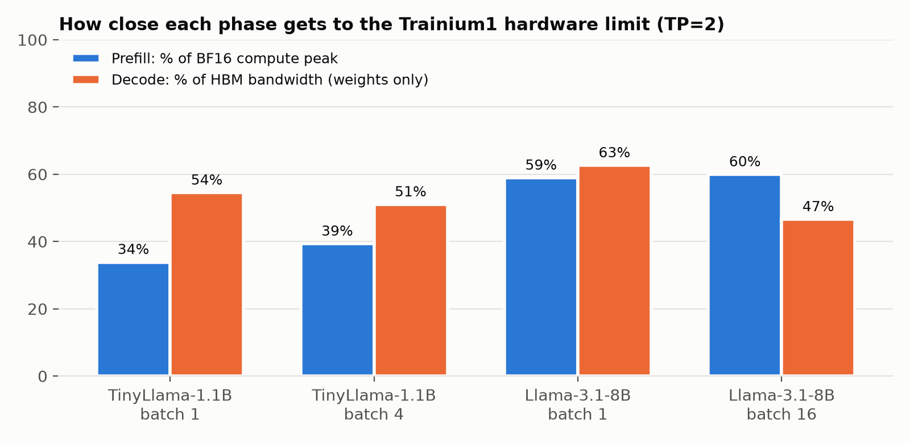

# neuron-llm-profiling

Benchmark and profile Llama-3.1-8B-Instruct inference on one AWS Trainium chip (trn1.2xlarge), find out
how close each phase of inference gets to the hardware's limits, and keep everything (numbers, traces,
compiled models) so each experiment builds on the last.

## Paper

**How Close Does LLM Inference Get to the Hardware Limit on a Single AWS Trainium1 Chip?**
A technical report (6 pages, not peer reviewed) on TinyLlama-1.1B and Llama-3.1-8B, about $6 of compute.
[PDF on Google Drive](https://drive.google.com/file/d/1ny5Tuo9CQInpW2IgNT01K5OBFxfbwHCi/view) ·
[`paper/main.pdf`](paper/main.pdf) · source in [`paper/`](paper/) (`tectonic -X compile paper/main.tex`;
figures from `uv run --with matplotlib paper/figures.py`).



| Finding | Number |
|---|---|
| Decode, % of HBM bandwidth floor (TP=2, batch 1) | 54% (1.1B) → 63% (8B) |
| Prefill, % of BF16 compute peak (TP=2, batch 1) | 34% (1.1B) → 59% (8B) |
| TP=2 vs TP=1 decode, 1.1B model | 1.9× faster despite the all-reduce |
| Llama-3.1-8B batch 1 → 16 | 12× decode tokens/s for 34% more step time |
| vLLM time per output token vs NxDI decode step (1.1B) | ~55% higher |

## Objective

1. **Baseline:** for an 8B model in bf16 on one Trainium1 chip, measure prefill latency, decode latency per token,
   throughput, and serving latency (TTFT/TPOT) under concurrency.
2. **Explain the gap:** compare each phase with its hardware floor. Decode is limited by memory bandwidth
   (16 GB of weights / 820 GB/s = 19.6 ms/token minimum); prefill is limited by compute (~190 BF16 TFLOPS).
   Device profiles show where the rest of the time goes: matmul engine, vector/scalar engines, DMA, collectives.
3. **Optimize from evidence:** change one knob per run (batch size, NxDI's built-in NKI kernels, int8 weights,
   then custom kernels) and keep the ones that move the measured number.

Compiling an 8B model is the slow, expensive part, so compiled models are cached in S3 and reused by every
later box. A Trainium hour is spent on measuring, not compiling.

## Runbook

### 0. One-time setup (done already unless noted)

- AWS credentials: `aws login`. The account needs on-demand quota for 8 Trn vCPUs (granted) and 16 standard
  vCPUs for the compile box. `./infra/regions.sh` shows quotas per region; `launch.sh` checks before creating anything.
- `gh auth login` (GitHub CLI, for the repo and per-launch deploy keys).
- Storage: `./infra/storage.sh` creates a private bucket `neuron-lab-<account>-us-east-1` and an instance role
  that can only read/write that bucket. `launch.sh` runs it automatically, so this is optional.

### 1. Compile on a CPU box (about 1 hour, ~$1)

```bash
MODE=compile ./infra/launch.sh       # m7i.4xlarge, 16 vCPU / 64 GiB, no Trn quota needed
git pull                             # results/<ts>-compile/RUN.md: cache hit/miss, compile time, peak host RAM
```

The box compiles every `TPS x BATCHES` variant in `bench/config.env` for trn1 (`NEURON_PLATFORM_TARGET_OVERRIDE=trn1`),
uploads each to `s3://<bucket>/compiled/<model>/<variant>/`, and powers off. If compile mode doesn't work for
this SDK (not yet verified on 2.28), the run log says so and step 2 compiles on the Trainium box instead, then caches.

### 2. Measure on Trainium (60 min budget, ~$1.34)

```bash
./infra/launch.sh                    # trn1.2xlarge; pulls cached variants, ~2-4 min each instead of a compile
git pull                             # results/<ts>-run/ land every 10 min and after every step
```

Steps: inventory, swap, model download, `compile_*` (cache), `bench_*` (latency), `profile_tp2` (traces),
`vllm_tp2` (serving), `roofline`, `plots`. The box powers off when done; the 60-minute timer is only the backstop.

### 3. Review

- `results/<run>/RUN.md`: versions, step results, latency and serving tables.
- `results/<run>/plots/`: `phase_latency.png`, `roofline_efficiency.png`, `vllm_serving.png`.
  Regenerate anywhere: `uv run --with matplotlib bench/plots.py results/<run>`.
- `results/<run>/profile_summary_tp2.txt`: per-graph engine use, MFU/MBU, spills, collectives.
- Raw traces: `aws s3 sync s3://<bucket>/profiles/<run>/ traces/`, then `neuron-explorer view -d traces/tp2`
  on any Linux x86 machine (no Neuron device needed).
- Write a `LOGBOOK.md` entry: what happened, what the numbers say, what to try next.

### 4. Iterate

Edit one knob in `bench/config.env`, commit, repeat steps 1-3. A new knob is a new cache variant (compile once);
unchanged variants are cache hits. `./infra/teardown.sh` (and `MODE=compile ./infra/teardown.sh`) removes the
deploy key and confirms the box is gone.

## Persistent storage (S3)

| Path | What | Reuse |
|---|---|---|
| `compiled/<model>/<variant>/` | NxDI compiled model: NEFFs, `neuron_config.json`, per-core sharded weights (~16 GB) | any trn1 box with the same SDK |
| `vllm/<model>/<variant>/` | vllm-neuron compiled artifacts | same |
| `profiles/<run>/` | raw NEFF/NTFF device traces | viewable without a Neuron device; expire after 90 days |

`<variant>` is e.g. `tp2-b1-ctx1024-seq2048-f12022247b`. The hash covers everything baked into the NEFFs (model,
TP, batch, lengths, sampling flags, `NXDI_EXTRA`, neuronx-cc and NxDI versions, target), so a change is a cache
miss rather than a stale hit. `manifest.txt` is uploaded last and marks a complete upload. Compiled models only
*run* on Trainium; S3 holds them between boxes. Storage is about $0.40/month per 8B variant.

## Infrastructure details

`launch.sh` runs `infra/network.sh`, which creates (once) and reuses an isolated `neuron-lab` VPC:
its own internet gateway, a public subnet in each AZ that offers the instance type, an allow-all network ACL,
and a security group that allows SSH only from `SSH_CIDRS` (default: your current public IP). If your public IP
rotates, pass all of them: `SSH_CIDRS="<redacted-ip>/32 <redacted-ip>/32" ./infra/launch.sh`.
`./infra/destroy-network.sh` removes it when you're done with Trainium for good.

Both modes use the pinned Neuron 2.28 DLAMI: Neuron 2.29+ dropped Trn1 from NxD Inference, and compiled
artifacts only load on the exact SDK that built them.

### How the time limit and backups work

| Mechanism | When | What |
|---|---|---|
| `shutdown -P +MINUTES+2` | first line of user-data | backstop; poweroff = **terminate** (`--instance-initiated-shutdown-behavior terminate`) |
| `POWEROFF_WHEN_DONE=1` | when `run.sh` finishes | power off right away instead of idling until the timer |
| cron `autosave periodic` | every 10 min | `git add -A && commit && pull --rebase && push` |
| `bench/run.sh` | after every step | same autosave, so a timeout loses at most one step |
| systemd timer `neuron-lab-final` | MINUTES-5 | `autosave final`, then poweroff |
| `autosave-on-shutdown.service` | any shutdown/reboot | `ExecStop` push, before the network goes down |

Files over 50 MB (NEFF/NTFF, weights) are kept out of git; compiled models and raw traces go to S3 instead.

Git auth uses a **deploy key scoped to this one repo**, generated fresh per launch (one per mode) and deleted by
`teardown.sh`. It travels in user-data, which any process on the box and anyone with `ec2:DescribeInstanceAttribute`
can read. That's acceptable for a short-lived, single-repo key. AWS access on the box comes from the instance role,
which is limited to the lab bucket.

## Records

- `docs/REFERENCES.md`: papers and AWS docs behind the method and each optimization knob.
- `LOGBOOK.md`: one entry per launch: what was tried, what broke, root cause, fix commit, results, next steps.
- `results/<run>/RUN.md`: generated after every step on the box: instance, AMI, Neuron versions, config,
  step exit codes with the error line of each failure (compile steps also show cache hit/miss, compile time, peak host RAM),
  latency table, profile file sizes.
- `results/<run>/plots/`: charts generated at the end of each run.
- Commit messages: each step commits as `<step> rc=<code>`, and the last one carries the full step list.

## The local stack (top to bottom)

```
vLLM + vllm-neuron plugin     serving: continuous batching, OpenAI API     (vllm bench serve)
NxD Inference (NxDI)          model zoo, TP sharding, bucketing, KV cache,  (inference_demo --benchmark)
                              on-device sampling, speculative decoding
NxD Core / ModelBuilder       parallel layers, tracing into per-bucket graphs
torch-neuronx / JAX           framework -> HLO (XLA)
neuronx-cc + NKI              compiler: HLO -> NEFF (one binary per static shape); NKI = hand-written kernels
Neuron Runtime (libnrt)       loads NEFFs, DMA, executes, collectives      (NEURON_RT_* env vars)
Neuron driver (dkms)          /dev/neuron*                                  (neuron-ls, neuron-top, neuron-monitor)
Trainium1 chip                2 x NeuronCore-v2, 32 GB HBM @ ~820 GB/s, ~190 BF16 TFLOPS
  each NeuronCore:            TensorE (128x128 systolic matmul), VectorE, ScalarE (activations),
                              GpSimdE, 24 MB SBUF scratchpad, PSUM accumulators, DMA engines
```

trn1.2xlarge = 1 chip, 8 vCPU, 32 GiB host RAM. The 8 vCPUs make **compilation slow** (minutes per shape),
so the compile cache under `~/compiled/` is where most of a 1-hour budget goes.

Why this matters for profiling: Neuron compiles **static shapes**. NxDI builds separate NEFFs for
**context encoding** (prefill) and **token generation** (decode), one per bucket. That gives you natural
seams to profile LLM phases separately, with no code changes.

## Methodology (what `bench/run.sh` does)

1. **Pin the stack** (`inventory.log`): driver, runtime, compiler and framework versions. Numbers from
   different SDK versions aren't comparable.
2. **Fix the workload** (`config.env`): model, prompt length, output length, batch/concurrency. Commit it with the results.
3. **Measure end to end, split by phase** (`bench_b*/benchmark_report.json`): NxDI reports p50/p90/p99 for
   `e2e_model`, `context_encoding_model` (≈ TTFT) and `token_generation_model` (≈ per-token latency).
4. **Profile** (`profile_summary.txt`), using `NEURON_RT_INSPECT_ENABLE=1`:
   - *system profile*: runtime API timeline (host overhead, gaps between `nrt_execute` calls)
   - *device profile* (`NEURON_RT_INSPECT_DEVICE_PROFILE=1`): an instruction-level trace for the first run of each
     NEFF, so one trace for prefill and one per decode bucket. With `XLA_HLO_DEBUG=1` at compile time, ops keep their
     framework names (e.g. `layers.7.self_attn`), so you can attribute time to layers.
   - Read per-engine utilization (TensorE vs VectorE/ScalarE vs DMA). Decode should be DMA/HBM-bound;
     prefill should be TensorE-bound. If not, that's the lead to follow.
5. **Compare to a roofline** (`roofline.log`): decode floor = weight bytes / HBM BW; prefill floor = 2·params·tokens / peak FLOPs.
6. **Serving workload** (`vllm_c*.json`): TTFT/TPOT/ITL/throughput under concurrency. This is best effort:
   the current vLLM DLAMIs list only Trn2/Trn3, so the step is skipped if no vLLM venv exists on the Trn1 image.
7. **Change one knob, rerun, diff**: batch size, buckets, TP, seq len, a kernel. Every run is a timestamped folder in git.

### Profiling just one part of the model

- **One phase**: open the prefill or decode NEFF's trace from `~/profiles/<run>/` in the Neuron Explorer UI
  (`neuron-explorer view -d ~/profiles/<run>`; forward its port over `ssh -L`), or re-capture a single NEFF with
  representative inputs: `neuron-explorer capture -n model.neff -s out.ntff IN1 x.npy`.
- **One code region** (PyTorch, private beta): wrap it in `torch.profiler.profile(...)` with
  `torch_neuronx.profiling.NeuronConfig(modes=[ProfileMode.DEVICE, ProfileMode.RUNTIME])`, after 3+ warmup iterations.
- **One layer in isolation**: compile just that module (e.g. a single decoder layer at fixed shapes) and capture its NEFF.
  That's a clean way to A/B an NKI kernel against the compiler's default.
- **Filter at capture time**: `NEURON_RT_INSPECT_EVENT_FILTER_NC=0` (one core) to keep traces small.

`neuron-explorer` replaces the deprecated `neuron-profile` CLI. The scripts fall back to the old name if needed.
